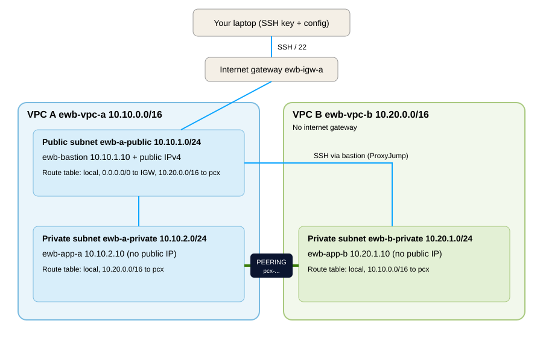

# AWS VPC Peering Project (EWB Courses, Project 01)

**Name:** Divya K  **Batch:** 1.1 **Region:** ap-south-1 (Mumbai)  **Date:** 01/11/2026

## Overview
Two VPCs are connected with VPC peering so that private EC2 instances in each VPC communicate over private IPv4 addresses. One public bastion host in VPC A is used for administration over SSH (ProxyJump). There is no public web application, so this project has no live URL. The proof is the AWS configuration and the test output in `screenshots/` and `outputs/`.

## Project status
| Phase | Status |
|---|---|
| Repository, diagram, templates, Terraform | Done |
| AWS account activation | In progress |
| AWS build and tests | Pending |
| Screenshots and report PDF | Pending |
| Cleanup evidence | Pending |

Items marked Pending have not been run yet and no results are claimed for them. This table is updated as each phase is completed.

## Architecture


| Resource | Name tag | CIDR / IP | Public IP |
|---|---|---|---|
| VPC A | ewb-vpc-a | 10.10.0.0/16 | n/a |
| Public subnet A | ewb-a-public | 10.10.1.0/24 | n/a |
| Private subnet A | ewb-a-private | 10.10.2.0/24 | n/a |
| VPC B | ewb-vpc-b | 10.20.0.0/16 | n/a |
| Private subnet B | ewb-b-private | 10.20.1.0/24 | n/a |
| Bastion | ewb-bastion | 10.10.1.10 | Yes |
| App-A | ewb-app-a | 10.10.2.10 | No |
| App-B | ewb-app-b | 10.20.1.10 | No |

Other resources: `ewb-igw-a`, route tables `ewb-rt-a-public`, `ewb-rt-a-private`, `ewb-rt-b-private`, security groups `ewb-sg-bastion`, `ewb-sg-app-a`, `ewb-sg-app-b`, peering `ewb-a-b-peer`, key pair `ewb-lab`. Real IDs go in `notes/resource-ids.md`.

## Route tables
| Route table | Destination | Target |
|---|---|---|
| ewb-rt-a-public | 10.10.0.0/16 | local |
| ewb-rt-a-public | 0.0.0.0/0 | ewb-igw-a |
| ewb-rt-a-public | 10.20.0.0/16 | pcx (ewb-a-b-peer) |
| ewb-rt-a-private | 10.10.0.0/16 | local |
| ewb-rt-a-private | 10.20.0.0/16 | pcx (ewb-a-b-peer) |
| ewb-rt-b-private | 10.20.0.0/16 | local |
| ewb-rt-b-private | 10.10.0.0/16 | pcx (ewb-a-b-peer) |

## Security group inbound rules
| Group | Rule | Source |
|---|---|---|
| ewb-sg-bastion | SSH TCP 22 | my public IPv4 /32 |
| ewb-sg-app-a | SSH TCP 22 | 10.10.1.10/32 |
| ewb-sg-app-a | ICMP Echo Request | 10.20.1.10/32 |
| ewb-sg-app-b | SSH TCP 22 | 10.10.1.10/32 |
| ewb-sg-app-b | ICMP Echo Request | 10.10.2.10/32 |

## Test results (fill in with real output)
| # | Test | Expected | Result | Evidence |
|---|---|---|---|---|
| 1 | App-A ping to App-B before peering | No replies | Pending | screenshots/ |
| 2 | App-A ping to App-B after routes | 4 replies, 0% loss | Pending | screenshots/ |
| 3 | App-B ping to App-A | 4 replies, 0% loss | Pending | screenshots/ |
| 4 | `ssh ewb-app-b` through bastion | Shell on App-B | Pending | screenshots/ |
| 5 | No public IPv4 on App-A and App-B | Empty field | Pending | screenshots/ |
| 6 | ICMP rule removed, then restored | Fails, then recovers | Pending | screenshots/ |

## Forward path and return path
_To be written in my own words after the build._

## Cleanup
_Cleanup evidence to be added after the build._

## What I learned
_To be written after the build._

## Repository layout
```
docs/         architecture diagram, report template, viva answers, final report PDF
screenshots/  labeled AWS screenshots (checklist in screenshots/README.md)
outputs/      saved ping and ssh terminal output
notes/        resource IDs
ssh/          config.example (placeholder IP, no keys)
commands/     verification script
terraform/    optional Terraform version of the build
```
Private keys are never committed (`*.pem` is in `.gitignore`).
